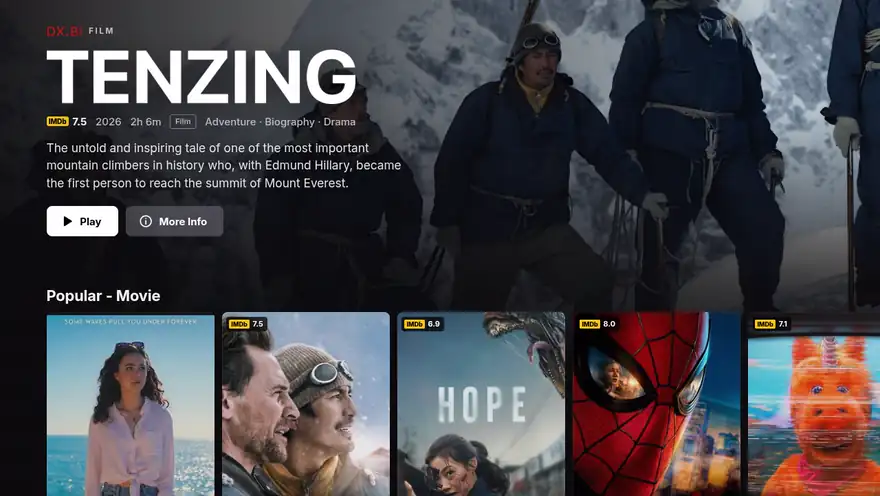
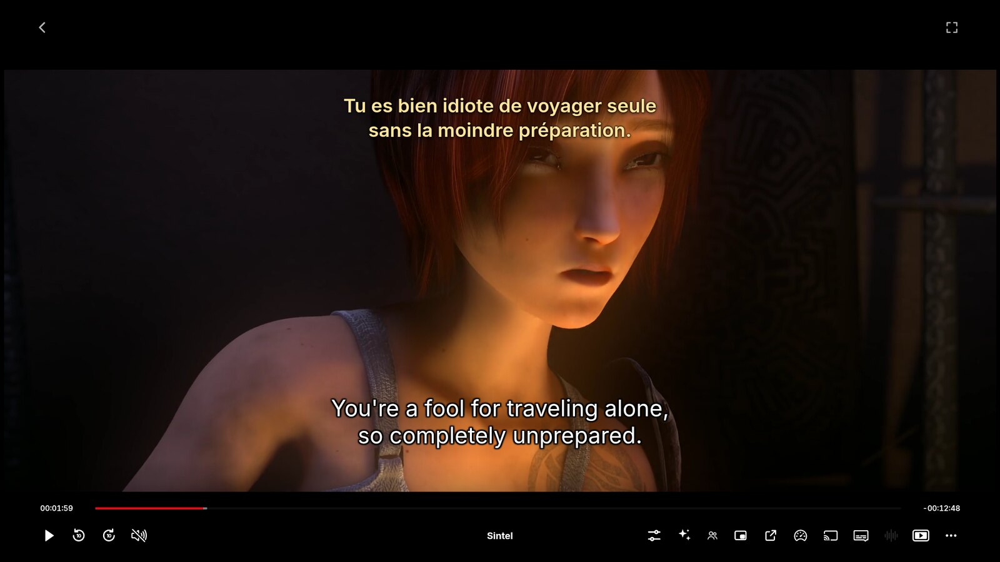
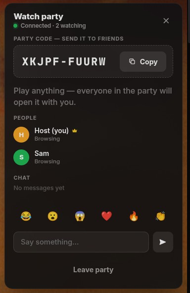
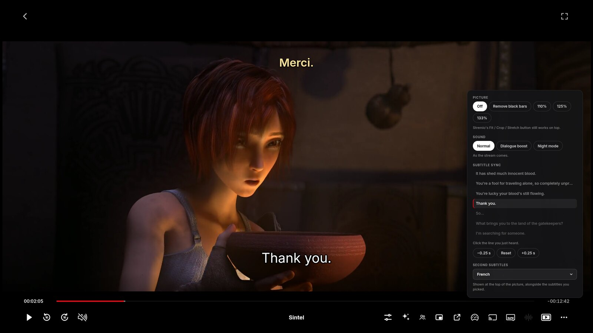
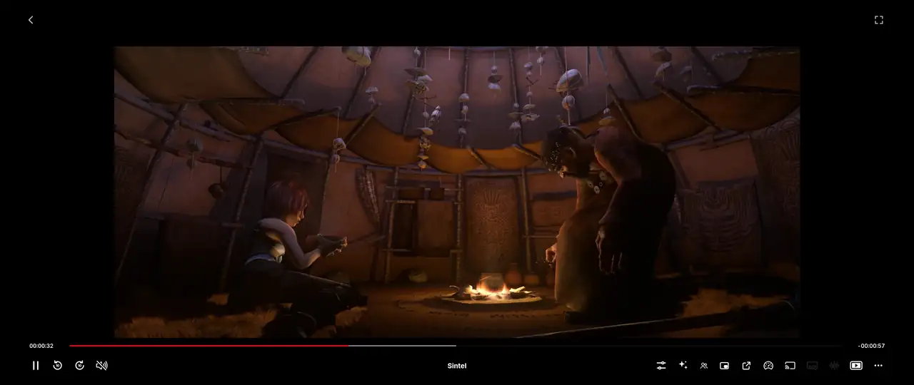
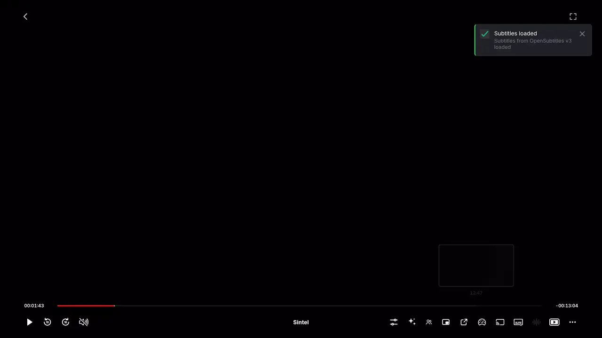
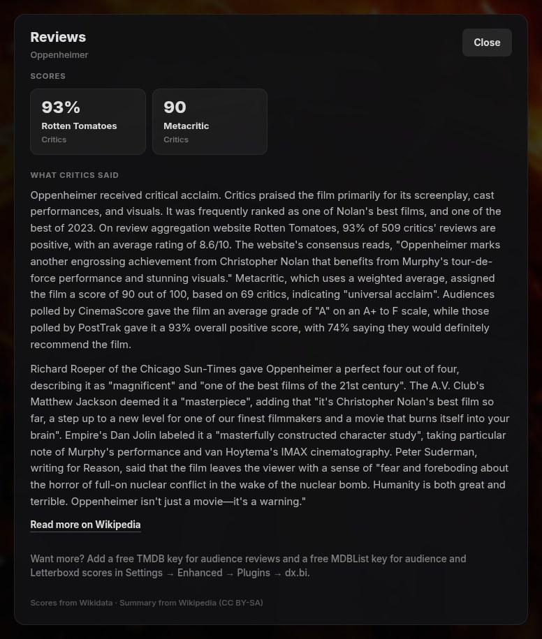

<p align="center">
  
</p>

<p align="center">
  <b>A Netflix-style Stremio, as its own desktop app or as a plugin for <a href="https://github.com/REVENGE977/stremio-enhanced">Stremio Enhanced</a>.</b><br>
  Works with your existing addons. Nothing to configure.
</p>

<p align="center">
  <a href="https://github.com/notdxbi/dxbi-stremio/releases/latest"></a>
  
  <a href="LICENSE"></a>
</p>

<p align="center">
  <a href="https://github.com/notdxbi/dxbi-stremio/releases/download/v2.5.1/dxbi-promo.mp4"><b>▶ Watch the 50-second preview</b></a>
</p>

<p align="center">
  
</p>

> [!NOTE]
> DX.BI is a personal fan project I made for my own use and decided to share. It was built with the help of [Claude Code](https://www.anthropic.com/claude-code), Anthropic's AI coding assistant. It isn't affiliated with Netflix, Stremio or Stremio Enhanced.

<br>

## Read this first

> [!IMPORTANT]
> DX.BI only changes how Stremio looks and feels. It doesn't add any movies, shows or streams, and it doesn't make anything play on its own.
>
> Titles play exactly the way they already do in your Stremio. If nothing plays in your Stremio today, nothing will play with DX.BI either.

To actually watch things you need a working Stremio setup first:

1. A Stremio account, signed in to the dx.bi app, or to [Stremio Enhanced](https://github.com/REVENGE977/stremio-enhanced/releases) if you use the plugin. The plugin is made and tested on Stremio Enhanced's latest full release, currently 1.2.0. Preview and test builds (such as 1.3.0-preview) aren't supported and can break the player.

2. Catalog addons, for what shows up on Home and Discover. Cinemeta is built in; others (TMDB, anime catalogs, streaming-service catalogs) are optional. On a fresh account DX.BI offers to add the free ones its own Home uses.

3. Stream addons, which provide the actual video. Many people link a debrid service such as [Real-Debrid](https://real-debrid.com/) to a stream addon; free and official sources exist too.

Setting those up is outside this project, and Stremio's community has plenty of guides. What you watch and where it comes from is your responsibility, so please follow the laws where you live.

<br>

## Install

There are two ways to get dx.bi. Both give you the same thing.

### The dx.bi app (easiest)

A desktop app with dx.bi built in: download it, open it, sign in. It's built on Stremio Enhanced, so it does everything Stremio Enhanced does.

| Computer | Download from the [latest release](https://github.com/notdxbi/dxbi-stremio/releases/latest) |
|---|---|
| Windows | `dxbi-…-Setup-x64.exe` (installer) or `dxbi-…-portable-x64.exe` |
| macOS (Apple silicon) | `dxbi-…-mac-arm64.dmg` |
| macOS (Intel) | `dxbi-…-mac-x64.dmg` |
| Linux | `dxbi-…-linux-x86_64.AppImage` (or `arm64`) |

- Already using Stremio Enhanced? The first time it opens, the app offers to copy your sign-in, library, settings and plugins over, so it starts just as you left it. Stremio Enhanced itself isn't changed.

- Stremio's streaming server (for torrents and files the built-in player can't open) is downloaded and kept up to date by the app. On Windows you can choose Stremio Service instead.

- macOS: the app isn't signed with an Apple certificate. The first time, right-click dx.bi in Applications and choose Open.

- Linux: make the AppImage executable (`chmod +x`, or Properties → Permissions), then open it.

dx.bi updates itself inside the app, and the app tells you when a new version of it is out.

### The plugin, for Stremio Enhanced

#### 1. Run one command

On Windows, open PowerShell and paste:

```powershell
irm https://github.com/notdxbi/dxbi-stremio/releases/latest/download/install.ps1 | iex
```

On macOS or Linux, open Terminal and paste:

```bash
curl -fsSL https://github.com/notdxbi/dxbi-stremio/releases/latest/download/install.sh | bash
```

#### 2. Restart Stremio Enhanced

#### 3. Turn it on

Go to *Settings → Enhanced* and switch the dx.bi plugin on. The theme is built into the plugin, so that's all you need.

Updates are offered automatically inside the app.

<details>
<summary>Prefer to install by hand?</summary>
<br>

1. Download [`dxbi.plugin.js`](https://github.com/notdxbi/dxbi-stremio/releases/latest/download/dxbi.plugin.js).
2. In Stremio Enhanced, go to *Settings → Enhanced*, open *Open Plugins Folder* and put the file there.
3. Restart and switch the plugin on.

The look is built into the plugin, so no theme file is needed. Applying any other theme switches the built-in one off.
</details>

<br>

## What you get

<p align="center">
  
</p>

### Browsing

<p align="center">
  
</p>

- **Cinematic intro** — plays once at startup with its own sound. Press <kbd>Esc</kbd> to skip.

- **Rotating billboard** — a big banner on Home with title art, rating, synopsis, Play and More Info.

- **Netflix-style rows** — scroll sideways with arrows.

- **Hover previews** — rest on a title and its card unfolds with a soft glow while the row makes room, showing its rating, genres and trailer. One click takes the trailer full screen.

- **Keyboard browsing** — get around everything with the arrow keys. The pointer hides while you do, the title you land on previews just like a hovered one, rows turn to their next page at the edge, and moving the mouse hands control straight back.

- **Ratings on posters** — IMDb scores from your own addons. Anime gets its Kitsu or AniList score.

- **Reviews on title pages** — Rotten Tomatoes and Metacritic scores beside the IMDb rating, and a Reviews button with what critics said. Works without an account; free keys add audience reviews and more scores.

- **Wide Continue Watching** — landscape cards with title art and progress.

- **Watched titles** — optionally dim or hide what you've already seen in Discover, Search and Home.

### The player

- **Redesigned controls** — seek-bar thumbnails, time remaining, ±10 seconds, Next Episode, and clean subtitle and speed menus.

- **Picture & sound panel** — the sliders button in the player:
  - remove black bars that are part of the video (great on ultrawide screens), or zoom in
  - Dialogue boost and Night mode, for quiet speech and loud explosions
  - sync subtitles by clicking the line you just heard
  - a second subtitle language on top, handy for learning a language

- **Picture enhancement** — real-time upscaling on your graphics card. [Anime4K](https://github.com/bloc97/Anime4K) for anime, sharpening for movies.

- **Stream stats** — press <kbd>D</kbd> or the chart button: resolution, codecs, HDR, bitrate, buffer, dropped frames and live download speed for every stream, with peers for torrents. Replaces Stremio's torrent-only statistics.

- **Skip Intro and Next Episode** — buttons from community skip databases, for movies, series and anime.

- **Up next** — a countdown to the next episode when the credits roll. The next episode is loaded in advance so it starts sooner.

- **Open in mpv or VLC** — for files that won't play or stutter here.

- **Picture-in-picture** — keep watching in a small window.

- **Keyboard controls** — press <kbd>Enter</kbd> to step into the player's buttons and menus, move with the arrows, and press <kbd>Esc</kbd> to step back out.

- **Remembers volume and speed** — and keys <kbd>0</kbd>–<kbd>9</kbd> jump through a video. Press <kbd>?</kbd> for every shortcut.

### Series and anime

- **Anime filler guide** — filler episodes marked in long anime, with an option to skip them.

- **New episode badges** — on shows in your library.

- **Airing this week** — a Home row with countdowns to upcoming episodes.

### Your library and addons

- **Library sorting** — newest, oldest or top rated, plus a genre filter.

- **Stream sorting and filters** — by quality, seeds, size, language, source, provider, instant (cached) and HDR.

- **Addon order and backup** — reorder, back up and restore your addons.

### Together and personal

- **Watch party** — watch in sync with friends, with chat and reactions. End-to-end encrypted.

- **Who's watching?** — separate viewers, each with their own stats and volume.

- **Your stats** — hours watched, streaks, top titles and genres, in your profile menu.

- **Look and feel** — every page restyled, 8 accent colours, soft interface sounds, and an on/off switch for every feature.

<br>

<table>
  <tr>
    <td></td>
    <td></td>
  </tr>
  <tr>
    <td align="center"><sub>Hover preview</sub></td>
    <td align="center"><sub>Movie page</sub></td>
  </tr>
  <tr>
    <td></td>
    <td></td>
  </tr>
  <tr>
    <td align="center"><sub>Series page</sub></td>
    <td align="center"><sub>Discover</sub></td>
  </tr>
  <tr>
    <td></td>
    <td></td>
  </tr>
  <tr>
    <td align="center"><sub>Player with seek-bar preview</sub></td>
    <td align="center"><sub>Two subtitle languages at once</sub></td>
  </tr>
</table>

<p align="center"><sub>Player shots use <a href="https://durian.blender.org/">Sintel</a> (© Blender Foundation, CC BY 3.0).</sub></p>

<br>

## A closer look

### Watch party



1. Click the people button (top right, or in the player), enter your name and choose *Start a party*.

2. Copy the code and send it to your friends. They paste it under *Join*.

3. Play anything. Each friend's Stremio opens the same title, picks the same release from their own addons, and jumps to your spot.

Once you're watching:

- anyone can pause, play or skip, and it happens for everyone
- if someone is buffering, everyone waits for them
- the party follows the host to the next episode
- chat and reactions appear in the player

Stream links are never shared, because debrid links contain your API key. Friends only receive the title, the release's torrent hash and the playback position. Everything is end-to-end encrypted with the party code and passed through public relays that only see scrambled data. No account and no server to run.

Each friend needs Stremio Enhanced on a computer with the dx.bi plugin, plus their own stream addon. If they don't have the exact release, the closest match is used.

<br clear="right">

### Picture & sound panel

Click the sliders button in the player.

<p align="center">
  
</p>

- **Picture** — *Remove black bars* measures the picture and crops off bars that are part of the video file, such as a widescreen film inside a 16:9 file. You can also zoom to 110%, 125% or 133%. Stremio's own Fit / Crop / Stretch button still works on top.

- **Sound** — *Dialogue boost* lifts voices and the centre speaker. *Night mode* also evens out loud and quiet scenes, so you can keep the volume down. Both work with 5.1 and stereo.

- **Subtitle sync** — shows the lines around the current moment. Click the line you just heard and the subtitles move to match. Fine-tune with ±0.25 s.

- **Second subtitles** — choose another language to show at the top of the picture.

<p align="center">
  <br>
  <sub>Remove black bars, on a 21:9 ultrawide screen</sub>
</p>

<p align="center">
  <br>
  <sub>Subtitles 4 seconds late, fixed with one click</sub>
</p>

### Reviews



Every movie and show page gets critics' scores next to its IMDb rating, and a *Reviews* button beside *Trailer*.

- *Scores*: Rotten Tomatoes and Metacritic, from Wikidata.
- *What critics said*: the critics' summary from the title's Wikipedia article, with a link to read more.

That works for everyone with no setup. Two free keys add more, and each one is only ever sent to its own service:

- A *TMDB key* adds audience reviews. Sign up at [themoviedb.org](https://www.themoviedb.org/signup), open *Settings → API*, and paste the API key or the read access token.
- An *MDBList key* adds fresher scores, including Rotten Tomatoes audience, Letterboxd and Trakt (1,000 titles a day). Sign in at [mdblist.com](https://mdblist.com), open *Preferences*, and copy the API key.

Paste them under *Reviews* in dx.bi's settings, then press *Close* to save.

<br clear="right">

### Picture enhancement

Makes anime, especially older or lower-resolution episodes, look cleaner and sharper.

- *Anime4K* runs the real [Anime4K](https://github.com/bloc97/Anime4K) v4 restore and upscale shaders by bloc97.
- *Sharpen* gives live action a crisp upscale.
- *Auto* uses Anime4K for anime and Sharpen for everything else.

HDR keeps its correct colours, subtitles stay on top, and it steps down by itself if your graphics card can't keep up. Switch it in the settings or with the ✨ button in the player.

### Stream sorting and filters


A bar above every list of streams:

- sort by addon order, quality, seeds or size
- filter by quality (4K, 1080p, 720p, SD)
- by language, read from flags and release names
- by source (Remux, BluRay, WEB, HDTV)
- by provider, when you have more than one stream addon
- instant only (cached debrid links), and HDR / Dolby Vision

It reads what your addons already show, so it works with any stream addon. Your choices are remembered.

<br clear="right">

<br>

## Settings

Find them in *Settings → Enhanced → dx.bi → ⚙*. Changes apply instantly.


Look
- accent colour, built-in theme
- billboard: on/off, content and speed
- hover previews, trailers, ratings, wide Continue Watching
- reviews on title pages, with optional TMDB and MDBList keys
- only movie, series and anime rows on Home
- watched titles: show, dim or hide

Player
- player extras, seek-bar previews, time remaining
- picture enhancement, the Picture & sound panel and stream stats
- skip buttons and auto-skip, up next countdown
- subtitle style and font, subtitles on HDR, whether subtitles start on
- convert videos this PC can't play
- picture-in-picture, Open in mpv / VLC
- get the next episode ready

Everything else
- library sorting, stream sorting, addon order and backup
- anime filler guide, new episode badges, airing row
- remember volume and speed, keyboard shortcuts
- watch stats, Who's watching?, watch party options
- intro animation and sound, interface sounds

<br clear="right">

<br>

## One plugin, nothing else needed

Everything is in the dx.bi plugin, theme included, written from scratch so nothing clashes.

These plugins do the same jobs, so turn them off or things will show twice:

> TheIntroDB, IntroDB, Stremio Intro Skip, AniSkip, Stremio Addon Manager, Addon Organizer, Enhanced Video Player, Picture in Picture, Context Menu Fix, Dynamic Hero, Horizontal Navigation, EnhancedCovers, Enhanced Title Bar, and [Lumen](https://github.com/echodzns04/echo-stremio-plugins).

Plugins that do something DX.BI doesn't (for example library folders or random pick) work alongside it. Any addons work: DX.BI uses whatever yours provide.

<br>

## FAQ

### I installed it but nothing plays

DX.BI is only a reskin (see [Read this first](#read-this-first)). Playback comes from your stream addons.

### It looks half-styled

Check that the plugin is on, that *dx.bi look built in* is on in its settings (or the dx.bi theme is applied), and that the plugins listed above are off.

### My Home has different rows from the screenshots

Home's rows come from the catalog addons on your account, not from DX.BI. On a fresh account DX.BI offers once to add the free catalogs its own Home uses: The Movie Database, Streaming Catalogs, Anime Catalogs and TMDB Collections. No accounts or keys needed. You can add or undo them any time from *Addons → Order & backup*. Stream addons are your own choice and are never added.

### "Video is not supported"

Stremio couldn't play that file, and DX.BI shows why underneath. Usually it's one of two things:

- Stremio's streaming server isn't running. Torrents and formats like MKV, HEVC and Dolby Vision need it. Restart Stremio Enhanced and accept its streaming-server setup; on Windows, *Stremio Service* is easiest. *Settings → Streaming* shows whether it's online.
- The format doesn't play on that computer (common on Windows 10). DX.BI has the streaming server convert these automatically. If it still fails, pick an x264 or WEB-DL release, or use *Open in mpv / VLC*.

### Windows: "Probe process exited with code: 3221225781"

Windows couldn't start the streaming server's video tool (ffprobe) because a file it needs is missing. To fix it, try these in order:

- Switch to *Stremio Service*, which brings its own working copy. Install it and choose it when Stremio Enhanced starts.
- Or close Stremio Enhanced and delete `ffmpeg.exe` and `ffprobe.exe` in `%APPDATA%\stremio-enhanced\streamingserver`. Fresh copies are downloaded on the next start.
- If you've installed ffmpeg yourself, Stremio Enhanced uses that copy first when it's on your PATH. Update it or remove it from the PATH.

### A green screen says "Torrent is being downloaded to debrid…"

That release isn't cached on your debrid service yet. It's a short clip from your stream addon, not a DX.BI error. Pick a release marked RD+ or ⚡ to watch straight away.

### Subtitles turn on by themselves

Not any more. *Subtitles when a video starts* is Off by default, like Netflix. Turn them on from the player's subtitles menu, or choose *On, in my Stremio subtitle language* in the settings.

### How do I remove it?

Switch the plugin off and apply the *Default* theme. Nothing else is changed.

### Does it collect anything?

No tracking and no accounts. It only asks public services about the titles you're looking at, never about you:

- ratings and artwork: Cinemeta, MetaHub, Kitsu, AniList
- skip times: TheIntroDB, AniSkip
- filler lists: animefillerlist.com
- reviews: Wikidata and Wikipedia; TMDB and MDBList only if you add your own key
- trailers: YouTube (privacy-enhanced mode, only while a trailer plays)
- fonts: Google Fonts and jsDelivr

Watch stats and viewers stay on your computer. *Order & backup* talks to Stremio's own servers only when you press Save or Restore. Watch parties only connect while you're in one, and are end-to-end encrypted.

### A giant black arrow covers the video and every click goes back

That comes from a preview build of Stremio Enhanced. Install the latest full release (currently 1.2.0) from its [releases page](https://github.com/REVENGE977/stremio-enhanced/releases), skipping anything marked Pre-release. Since 2.10.6 DX.BI also keeps that arrow small on its own.

### Does it work on my phone or TV?

Not yet. dx.bi is a desktop app (and a Stremio Enhanced plugin) for Windows, macOS and Linux. The official Stremio apps for phones and TVs can't load plugins. A dx.bi app for Android TV is being worked on.

### A friend can't connect to a party

Check that you both typed the same code and are on dx.bi 2.6.0 or newer. Parties use several relays, including one on the normal web port, so they work on most networks.

### Something overlaps after a Stremio update

Stremio changes its interface now and then. [Open an issue](https://github.com/notdxbi/dxbi-stremio/issues) with a screenshot.

<br>

## Credits

- [Stremio](https://www.stremio.com/) ([stremio-web](https://github.com/Stremio/stremio-web)) — the app underneath everything.
- [Stremio Enhanced](https://github.com/REVENGE977/stremio-enhanced) by REVENGE977 — makes themes and plugins possible, and the dx.bi app is built on it (MIT, [app/LICENSE.md](app/LICENSE.md)).
- The plugin authors whose work showed what Stremio users want — TheIntroDB, Sul-404 (Addon Manager), Fxy and MrBlu03.
- [Anime4K](https://github.com/bloc97/Anime4K) by bloc97 — the shaders behind Picture enhancement, included unmodified under the MIT licence ([LICENSE-ANIME4K](LICENSE-ANIME4K)).
- Cinemeta and MetaHub for metadata and artwork; [Kitsu](https://kitsu.app) and [AniList](https://anilist.co) for anime scores; [TheIntroDB](https://theintrodb.org) and [AniSkip](https://aniskip.com) for skip times; [animefillerlist.com](https://www.animefillerlist.com) for the filler guide; [Wikidata](https://www.wikidata.org) (CC0) and [Wikipedia](https://en.wikipedia.org) (CC BY-SA) for review scores and critics' summaries; [MDBList](https://mdblist.com) for extra scores. Audience reviews come from [TMDB](https://www.themoviedb.org): this product uses the TMDB API but is not endorsed or certified by TMDB.
- Fonts: [Bebas Neue](https://github.com/dharmatype/Bebas-Neue) and [Inter](https://rsms.me/inter/) (SIL Open Font License).
- Country flags: [Twemoji](https://github.com/jdecked/twemoji) graphics (CC-BY 4.0) via the [Twemoji Country Flags](https://github.com/talkjs/country-flag-emoji-polyfill) font by TalkJS (MIT).
- Built with the help of [Claude Code](https://www.anthropic.com/claude-code).

<sub>Inspired by the Netflix interface; no Netflix logos, fonts, images or sounds are used. The intro and all sounds are original (see <a href="tools">tools</a>). Not affiliated with Netflix, Inc., Stremio, Stremio Enhanced or any plugin author. <a href="CHANGELOG.md">Changelog</a> · <a href="LICENSE">MIT License</a>.</sub>
