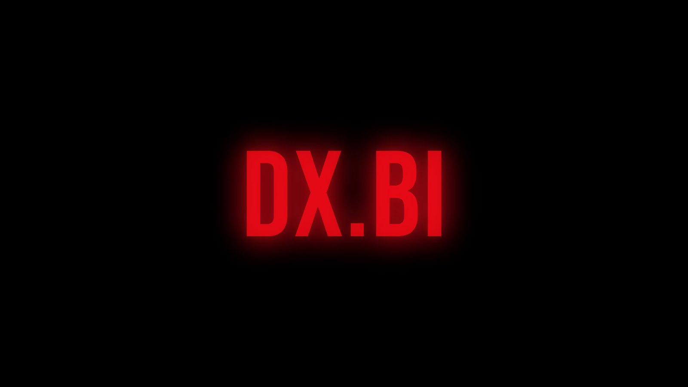

<h1 align="center">DX.BI</h1>

<p align="center">
  <b>A cinematic, Netflix-style skin for <a href="https://github.com/REVENGE977/stremio-enhanced">Stremio Enhanced</a>.</b><br>
  One theme + one plugin · works with your existing addons and most plugins · no accounts, no API keys.
</p>

<p align="center">
  <a href="https://github.com/notdxbi/dxbi-stremio/releases/latest"></a>
  <a href="LICENSE"></a>
</p>

<p align="center">
  
</p>

## Install

**Windows** — open PowerShell and paste:

```powershell
irm https://github.com/notdxbi/dxbi-stremio/releases/latest/download/install.ps1 | iex
```

**Linux / macOS** — open a terminal and paste:

```bash
curl -fsSL https://github.com/notdxbi/dxbi-stremio/releases/latest/download/install.sh | bash
```

Then restart Stremio Enhanced and in **Settings → Enhanced**: **Apply** the *dx.bi* theme and switch the *dx.bi* plugin **on**.

<details>
<summary>Manual install</summary>

1. Download [`dxbi.theme.css`](https://github.com/notdxbi/dxbi-stremio/releases/latest/download/dxbi.theme.css) and [`dxbi.plugin.js`](https://github.com/notdxbi/dxbi-stremio/releases/latest/download/dxbi.plugin.js) from the [latest release](https://github.com/notdxbi/dxbi-stremio/releases/latest).
2. In Stremio Enhanced → **Settings → Enhanced**: **Open Themes Folder** → drop the `.css` in; **Open Plugins Folder** → drop the `.js` in.
3. Restart, apply the theme, enable the plugin.

Folders, if you'd rather copy them yourself: Windows `%APPDATA%\stremio-enhanced`, macOS `~/Library/Application Support/stremio-enhanced`, Linux `~/.config/stremio-enhanced` (each has `themes/` and `plugins/`).
</details>

Updates: both files carry an `@updateUrl`, so Stremio Enhanced offers new versions automatically.

## What you get

| | |
|---|---|
| **Intro** | A 4-second cinematic intro film — the logo lands, the camera dives into it and it bursts into ribbons of light — with its own score. Pre-rendered and embedded (~265 KB), so it plays perfectly smooth while the app loads. Skip with <kbd>Esc</kbd>/<kbd>Enter</kbd>/click. |
| **Interface sounds** | Soft, designed sounds for tabs, opening titles, previews, My List, player controls and keyboard navigation. Synthesised on the fly — no audio files. |
| **Billboard** | Full-width rotating banner with title art, IMDb rating, year, runtime, genres, synopsis, **Play** and **More Info**. |
| **Rows** | Netflix-style horizontal carousels with arrows and page indicators. Rows that only show an addon error are hidden. |
| **Hover previews** | A card grows out of the poster: backdrop + logo, **Play**, **My List** (real Stremio library), more info, rating, length, genres. |
| **Ratings everywhere** | IMDb badges on posters from *your addons' own data* — Cinemeta, TMDB, anime catalogs, streaming catalogs — with Cinemeta filling gaps. Skipped on posters that already print a rating (RPDB & co). |
| **Continue Watching** | Wide landscape cards with title art and red progress bars. |
| **Details pages** | Full-bleed backdrops, cleaner metadata, a glass panel for episodes and streams. |
| **Player** | ±10s buttons, centred title, play/pause feedback, a dot-style speed picker, and a clean subtitles panel with ticks. |
| **Everything else** | Discover, Library, Search, Calendar, Addons, Settings, menus, dialogs and toasts restyled to match. |
| **Settings** | Accent colour (8 choices, the intro follows it), billboard source and speed, sound volume, and an on/off switch for every feature. Changes apply instantly. |

<p align="center">
  
  
</p>
<p align="center">
  
  
</p>
<p align="center">
  
  
</p>
<p align="center">
  
  
</p>

## Works with

Tested together with dx.bi (layouts adapt, nothing overlaps):

| Plugin | |
|---|---|
| TheIntroDB, IntroDB, Stremio Intro Skip, AniSkip | ✅ skip buttons restyled to match |
| Stream Quality Picker, Stream Keyword Filter, Stream Finder, FilterStreams, ExpandStreamTitles | ✅ their panels stack neatly on top of the streams list |
| Enhanced Video Player | ✅ its subtitle-style panel becomes a matching "Style" column |
| Context Menu Fix | ✅ account menu and context menus styled correctly |
| Stremio Addon Manager, Addon Organizer | ✅ |
| Collapsible Filters, Poster Size, Close Preview Panel, Discover Watched Filter, Random Pick, Library Stats, Library Folders, Slash to Search | ✅ |
| Picture in Picture | ✅ |
| Dynamic Hero, Horizontal Navigation, EnhancedCovers, Enhanced Title Bar | ❌ turn off — dx.bi already does these and they fight over the same layout |
| Lumen | ❌ turn off — it's another full redesign |

Addons: anything that provides catalogs/metadata/streams works — dx.bi reads what your addons return rather than assuming Cinemeta.

## Settings

**Settings → Enhanced → dx.bi → ⚙** — accent colour · billboard on/off, content, rotation · hover previews · IMDb ratings · wide Continue Watching · player extras · intro animation · intro sound · interface sounds · sound volume.

## Privacy & performance

- **No tracking, no accounts, no keys.** dx.bi only talks to endpoints Stremio already uses: Cinemeta (`v3-cinemeta.strem.io`) for ratings and the billboard, MetaHub (`images.metahub.space`) for artwork, and Google Fonts for *Inter* and *Bebas Neue*.
- Ratings/details are cached in the app's local storage (capped, expire after 3 days).
- **My List** uses Stremio's own library — the same thing the bookmark button does.
- Built to stay out of the way: work happens only when the page changes, metadata loads lazily for posters near the screen, nothing animates forever, and idle CPU use is effectively zero.

## Uninstall

Switch the dx.bi plugin off and apply the **Default** theme (or delete the two files). Nothing else is changed.

## Troubleshooting

- **Looks half-styled?** Both the theme must be applied *and* the plugin enabled, and the conflicting plugins above turned off.
- **No intro?** It plays once per app start. Check *Intro animation* in the dx.bi settings.
- **Too many/too few sounds?** *Interface sounds* and *Sound volume* in the dx.bi settings.
- **Something overlaps after a Stremio update?** Stremio's web UI changes occasionally — open an issue with a screenshot.

## Make it yours

The intro is generated, not hand-animated: [`tools/`](tools) contains the scripts that render the film and score. Change the text, colour or timing and re-render.

## Credits

- [Stremio](https://www.stremio.com/) and [Stremio Enhanced](https://github.com/REVENGE977/stremio-enhanced).
- [Bebas Neue](https://github.com/dharmatype/Bebas-Neue) and [Inter](https://rsms.me/inter/) (SIL Open Font License).
- Inspired by the Netflix interface. **dx.bi is an independent fan project and is not affiliated with, endorsed by, or connected to Netflix, Inc. or Stremio.** No Netflix logos, fonts, images or sounds are used — the intro and every sound are original.

## License

[MIT](LICENSE)
