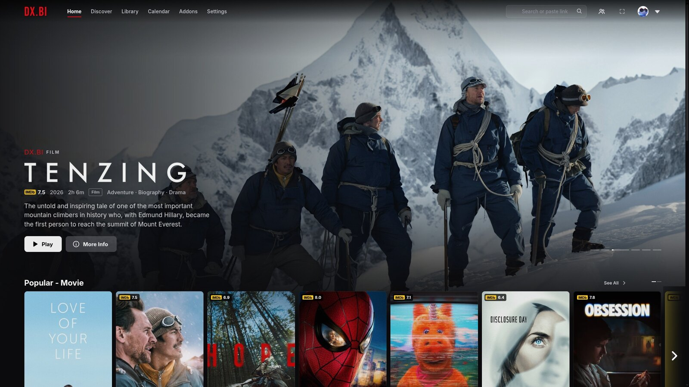
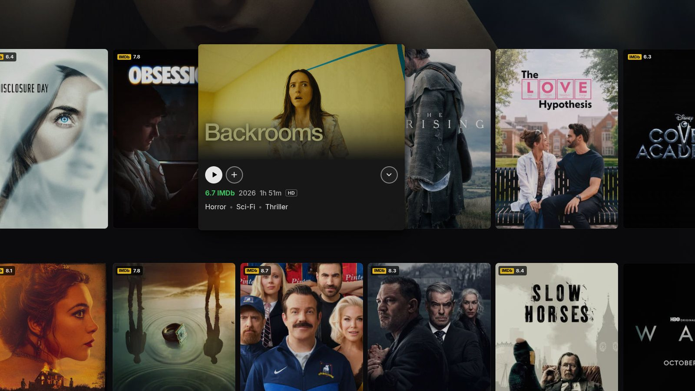
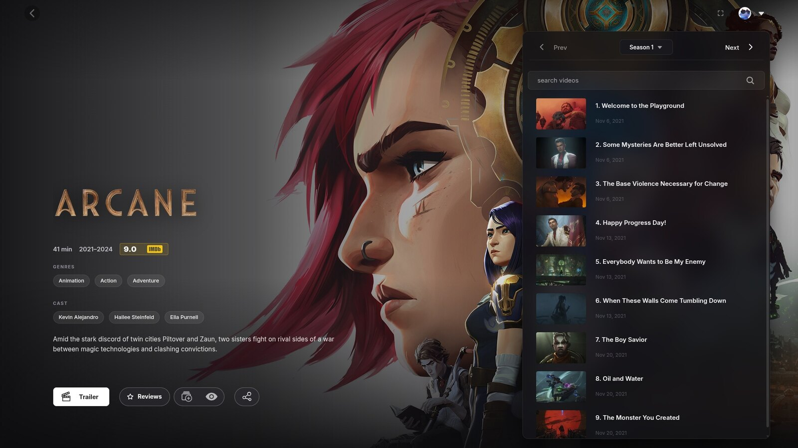
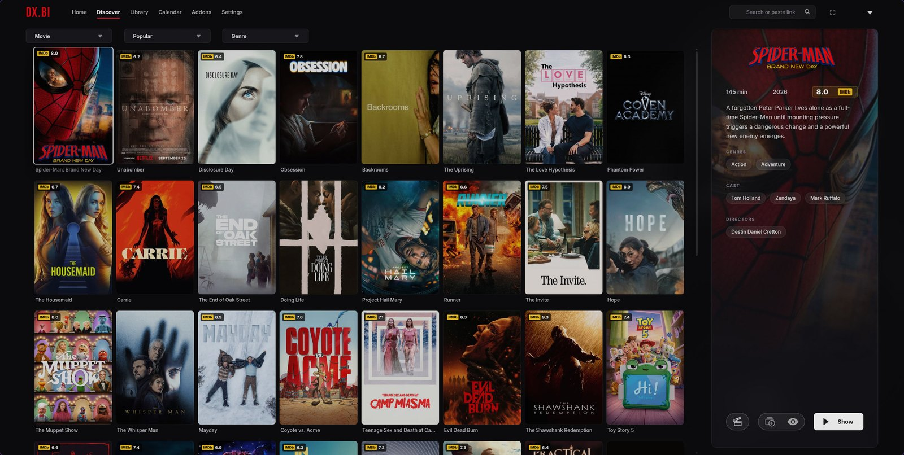
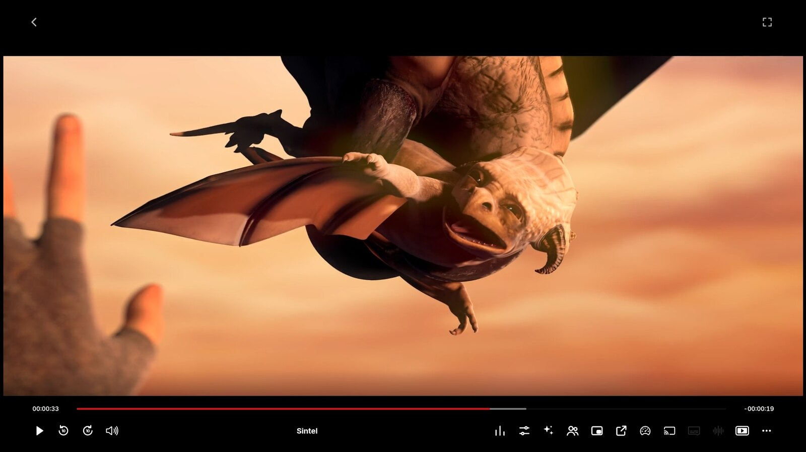
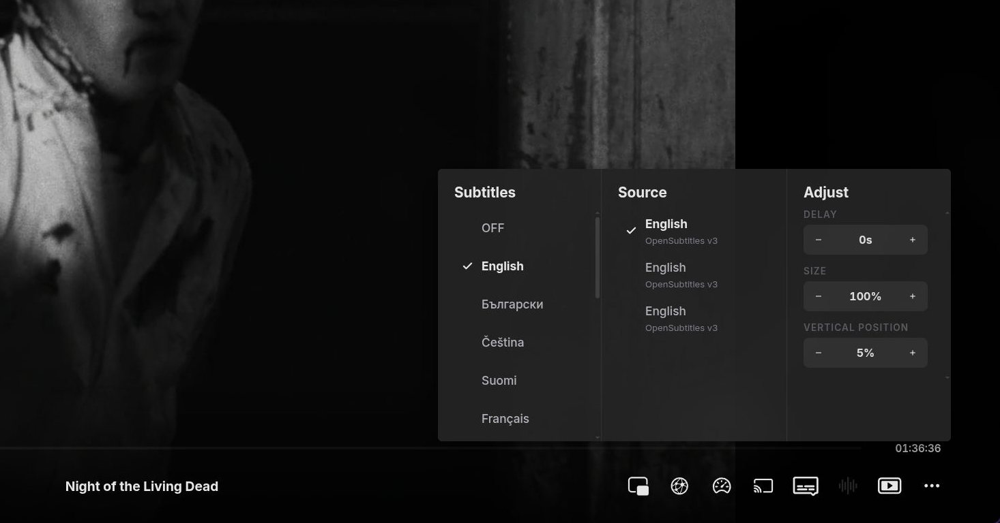
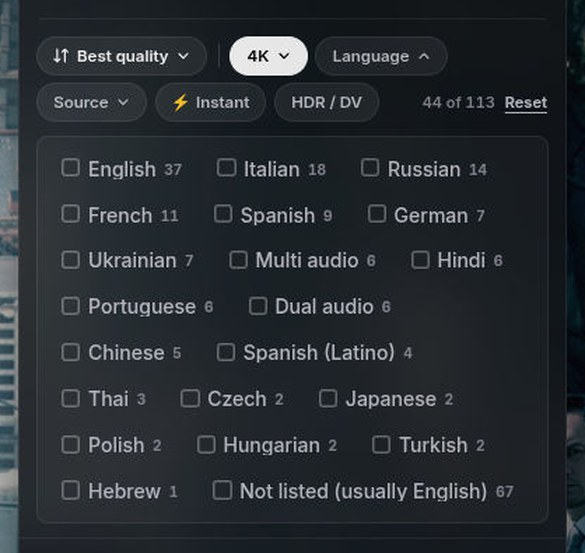
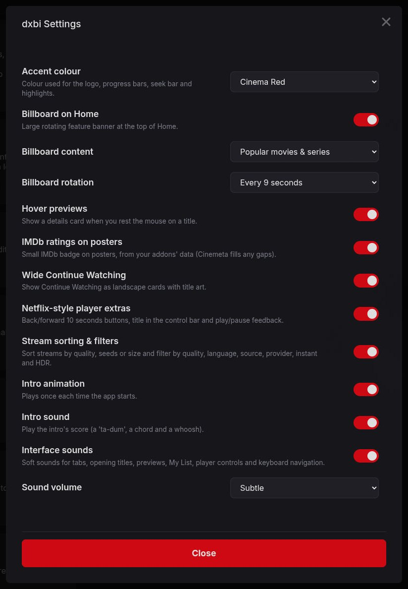

<p align="center">
  
</p>

<p align="center">
  <b>A Netflix-style look for <a href="https://github.com/REVENGE977/stremio-enhanced">Stremio Enhanced</a>.</b><br>
  One theme + one plugin. Works with your existing addons. Nothing to configure.
</p>

<p align="center">
  <a href="https://github.com/notdxbi/dxbi-stremio/releases/latest"></a>
  
  <a href="LICENSE"></a>
</p>

<p align="center">
  
</p>

> [!NOTE]
> **About this project** — DX.BI is a personal fan project I made for my own use and decided to share. It was built with the help of [Claude Code](https://www.anthropic.com/claude-code), Anthropic's AI coding assistant. It isn't affiliated with Netflix, Stremio or Stremio Enhanced.

---

## Read this first: it's a reskin, not a streaming service

> [!IMPORTANT]
> **DX.BI only changes how Stremio looks and feels.** It doesn't add any movies, shows or streams, and it doesn't make anything play on its own.
> Titles play exactly the way they already do in your Stremio — **if nothing plays in your Stremio today, nothing will play with DX.BI either.**

To actually watch things you need a working Stremio setup first:

1. **[Stremio Enhanced](https://github.com/REVENGE977/stremio-enhanced/releases)** installed and signed in to a Stremio account.
2. **Catalog addons** for what shows up on Home and Discover — *Cinemeta* is built in; others (TMDB, anime catalogs, streaming-service catalogs…) are optional.
3. **Stream addons** that provide the actual video sources. Many people link a **debrid service such as [Real-Debrid](https://real-debrid.com/)** to a stream addon for fast, reliable playback; free and official sources exist too.

Setting those up is outside this project — Stremio's community has plenty of guides. What you watch and where it comes from is your responsibility; please follow the laws where you live.

---

## Install

**1. Run one command**

Windows — open **PowerShell** and paste:
```powershell
irm https://github.com/notdxbi/dxbi-stremio/releases/latest/download/install.ps1 | iex
```

macOS / Linux — open **Terminal** and paste:
```bash
curl -fsSL https://github.com/notdxbi/dxbi-stremio/releases/latest/download/install.sh | bash
```

**2. Restart Stremio Enhanced**

**3. Turn it on** — *Settings → Enhanced*: click **Apply** on the **dx.bi** theme, and switch the **dx.bi** plugin **on**.

That's it. Updates are offered automatically inside the app.

<details>
<summary><b>Prefer to install by hand?</b></summary>
<br>

1. Download [`dxbi.theme.css`](https://github.com/notdxbi/dxbi-stremio/releases/latest/download/dxbi.theme.css) and [`dxbi.plugin.js`](https://github.com/notdxbi/dxbi-stremio/releases/latest/download/dxbi.plugin.js).
2. In Stremio Enhanced: *Settings → Enhanced* → **Open Themes Folder** (put the `.css` there) and **Open Plugins Folder** (put the `.js` there).
3. Restart, apply the theme, enable the plugin.
</details>

---

## What you get

<p align="center">
  
</p>

- **Cinematic intro** with its own sound — plays once at startup, skip with <kbd>Esc</kbd>
- **Rotating billboard** on Home with title art, rating, synopsis, **Play** and **More Info**
- **Netflix-style rows** — scroll sideways with arrows
- **Hover previews** — rest on a title for a card with **Play**, **My List**, rating and genres
- **IMDb ratings** on posters, using data from your own addons
- **Stream sorting & filters** — sort by quality, seeds or size; filter by quality, language, source, provider, ⚡ instant and HDR
- **Wide Continue Watching** cards with title art and progress
- **Redesigned player** — ±10 seconds, clean subtitle and speed menus
- **Subtle interface sounds** (adjustable or off)
- **Everything restyled** — Discover, Library, Search, Calendar, Addons, Settings
- **8 accent colours** and an on/off switch for every feature

<table>
  <tr>
    <td></td>
    <td></td>
  </tr>
  <tr>
    <td align="center"><sub>Hover preview</sub></td>
    <td align="center"><sub>Movie page</sub></td>
  </tr>
  <tr>
    <td></td>
    <td></td>
  </tr>
  <tr>
    <td align="center"><sub>Series page</sub></td>
    <td align="center"><sub>Discover</sub></td>
  </tr>
  <tr>
    <td></td>
    <td></td>
  </tr>
  <tr>
    <td align="center"><sub>Player</sub></td>
    <td align="center"><sub>Subtitles menu</sub></td>
  </tr>
</table>

### Stream sorting & filters



Above every list of streams:

- **Sort** — addon order, best quality, most seeds, largest or smallest
- **Quality** — 4K, 1080p, 720p, SD
- **Language** — read from flags and release names
- **Source** — Remux, BluRay, WEB, HDTV
- **Provider** — when you have more than one stream addon
- **⚡ Instant** — cached debrid links only
- **HDR / DV**

It reads what your addons already show, so it works with any stream addon. Your choices are remembered.

<br clear="right">

---

## Settings

*Settings → Enhanced → dx.bi → ⚙*



- Accent colour
- Billboard on/off, content and speed
- Hover previews
- IMDb ratings on posters
- Wide Continue Watching
- Player extras
- Stream sorting & filters
- Intro animation and intro sound
- Interface sounds and volume

Changes apply instantly.

<br clear="right">

---

## My setup

What I run alongside DX.BI — all optional, all made by other people:

| Plugin | What it does | By |
|---|---|---|
| [TheIntroDB](https://github.com/TheIntroDB/stremio-enhanced-plugin) | Skip intros, recaps and credits | TheIntroDB |
| [Stremio Addon Manager](https://github.com/Sul-404/Stremio-Addon-Manager) | Reorder, edit and back up addons | Sul-404 |
| [Enhanced Video Player](https://github.com/Fxy6969/Stremio-Glass-Theme) | Subtitle style presets | Fxy |
| [Picture in Picture](https://github.com/Fxy6969/Stremio-Glass-Theme) | Pop the player out | Fxy |
| [Context Menu Fix](https://github.com/Fxy6969/Stremio-Glass-Theme) | Keeps menus above everything | MrBlu03 (in Fxy's repo) |

## Works with

Tested together with DX.BI — layouts adapt and nothing overlaps.

| Plugin | By |
|---|---|
| [TheIntroDB](https://github.com/TheIntroDB/stremio-enhanced-plugin) · [IntroDB](https://github.com/Akar1881/stremio-enhanced-plugin) · [Stremio Intro Skip](https://github.com/shugi12345/stremio-skip-button) · [AniSkip](https://github.com/REVENGE977/stremio-aniskip) | TheIntroDB · Akar1881 · shugi12345 · REVENGE977 |
| [Stream Quality Picker](https://github.com/JZOnTheGit/stream-quality-picker) | JZOnTheGit |
| [Stream Keyword Filter](https://github.com/M-1u/stremio-stream-keyword-filter) | M-1u |
| [Stream Finder](https://github.com/echodzns04/echo-stremio-plugins) · [Addon Organizer](https://github.com/echodzns04/echo-stremio-plugins) | Echo |
| [FilterStreams](https://github.com/0xA18/stremio-enhanced-plugins) | 0xA18 |
| [ExpandStreamTitles](https://github.com/Enkvaros/stremio-enhanced-stream-titles-fixed) | Enkvaros |
| [Enhanced Video Player](https://github.com/Fxy6969/Stremio-Glass-Theme) · [Picture in Picture](https://github.com/Fxy6969/Stremio-Glass-Theme) · [Context Menu Fix](https://github.com/Fxy6969/Stremio-Glass-Theme) | Fxy · MrBlu03 |
| [Stremio Addon Manager](https://github.com/Sul-404/Stremio-Addon-Manager) · [Stremio Addon Manager (Zcc09)](https://github.com/Zcc09/stremio-addon-manager-plugin) | Sul-404 · Zcc09 |
| [Collapsible Filters](https://github.com/M-1u/stremio-collapsible-filters) · [Poster Size](https://github.com/M-1u/stremio-poster-size) · [Close Preview Panel](https://github.com/M-1u/stremio-close-preview-panel) · [Discover Watched Filter](https://github.com/M-1u/stremio-discover-watched-filter) · [Random Pick](https://github.com/M-1u/stremio-random-pick) · [Library Stats](https://github.com/M-1u/stremio-library-stats) · [Library Folders](https://github.com/M-1u/stremio-library-folders) | M-1u |
| [Slash to Search](https://github.com/REVENGE977/SlashToSearch) | REVENGE977 |

> [!TIP]
> DX.BI has its own stream sorting & filters, so you don't *need* a stream-filter plugin — but they work side by side if you like one.

**Turn these off** — they do the same job as DX.BI and clash with it: Dynamic Hero, Horizontal Navigation, EnhancedCovers and Enhanced Title Bar (from [Modern Glass](https://github.com/Fxy6969/Stremio-Glass-Theme)), and [Lumen](https://github.com/echodzns04/echo-stremio-plugins).

**Addons:** any — DX.BI uses whatever your addons provide (Cinemeta, TMDB, anime catalogs, streaming catalogs…).

---

## FAQ

**I installed it but nothing plays.** DX.BI is only a reskin — see [Read this first](#read-this-first-its-a-reskin-not-a-streaming-service). Playback comes from your stream addons.

**It looks half-styled.** Make sure the theme is applied *and* the plugin is on, and that the plugins under *Turn these off* are disabled.

**How do I remove it?** Switch the plugin off and apply the *Default* theme. Nothing else is changed.

**Does it collect anything?** No. No tracking, accounts or keys. It only loads ratings/artwork from Cinemeta and MetaHub (which Stremio already uses) and fonts from Google Fonts.

**Something overlaps after a Stremio update?** Stremio changes its web UI now and then — [open an issue](https://github.com/notdxbi/dxbi-stremio/issues) with a screenshot.

---

## Credits

- **[Stremio](https://www.stremio.com/)** ([stremio-web](https://github.com/Stremio/stremio-web)) — the app underneath everything.
- **[Stremio Enhanced](https://github.com/REVENGE977/stremio-enhanced)** by REVENGE977 — makes themes and plugins possible.
- **[Modern Glass](https://github.com/Fxy6969/Stremio-Glass-Theme)** by Fxy (with MrBlu03) — the theme I started from before building DX.BI, and the home of several plugins listed above.
- Every plugin author linked above — thank you for making Stremio better.
- **Cinemeta** and **MetaHub** for metadata and artwork.
- Fonts: [Bebas Neue](https://github.com/dharmatype/Bebas-Neue) and [Inter](https://rsms.me/inter/) (SIL Open Font License).
- Built with the help of [Claude Code](https://www.anthropic.com/claude-code).

<sub>Inspired by the Netflix interface; no Netflix logos, fonts, images or sounds are used — the intro and all sounds are original (see <a href="tools">tools</a>). Not affiliated with Netflix, Inc., Stremio, Stremio Enhanced or any plugin author. <a href="CHANGELOG.md">Changelog</a> · <a href="LICENSE">MIT License</a>.</sub>
