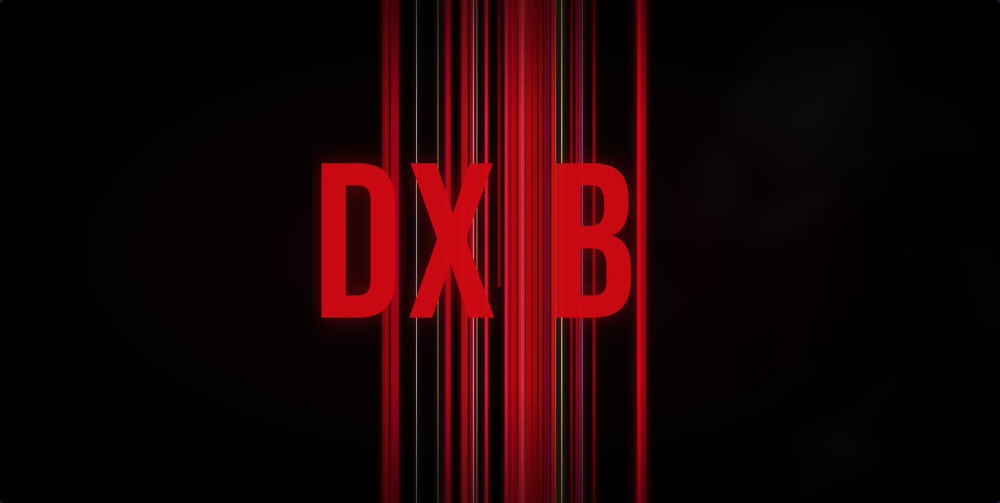

<h1 align="center">DX.BI</h1>

  <b>A cinematic, Netflix-style skin for <a href="https://github.com/REVENGE977/stremio-enhanced">Stremio Enhanced</a>.</b> 
  One theme + one plugin. No account changes, no API keys, nothing to configure.

  

---

## What you get

| | |
|---|---|
| **Intro** | Netflix-style animated intro: the logo lands, the camera dives into it and it bursts into ribbons of light. Optional sound. |
| **Billboard** | Full-width rotating banner with title art, IMDb rating, year, runtime, genres, synopsis, **Play** and **More Info**. Slow Ken Burns zoom, crossfades, pauses on hover. |
| **Rows** | Horizontal carousels with arrows and page indicators, like Netflix. Rows that only show an addon error are hidden. |
| **Hover previews** | Rest on a title and a card grows out of the poster: backdrop, logo, **Play**, **My List**, more info, rating, length and genres. |
| **IMDb ratings** | A small IMDb badge on every poster, fetched from Cinemeta and cached for 3 days. |
| **Continue Watching** | Wide landscape cards with title art and red progress bars. |
| **Details pages** | Full-bleed backdrops, cleaner metadata, a glass panel for episodes and streams. |
| **Player** | Netflix-style controls: ±10 second buttons, the title in the middle of the bar, play/pause feedback, a speed picker with dots, and a three-column subtitles panel with ticks. |
| **Everything else** | Discover, Library, Search, Calendar, Addons, Settings, menus, dialogs and toasts are all restyled to match. |
| **Settings** | Accent colour (8 choices), billboard source and speed, and an on/off switch for every feature. Changes apply instantly. |

  
  

  
  

  
  

  
  

## Install

You need the **Stremio Enhanced** desktop app (v1.2 or newer) — Windows, macOS or Linux.

1. Download [`dxbi.theme.css`](dxbi.theme.css) and [`dxbi.plugin.js`](dxbi.plugin.js)
   (open each file → **Download raw file**).
2. In Stremio Enhanced go to **Settings → Enhanced**:
   - **Open Themes Folder** → put `dxbi.theme.css` there.
   - **Open Plugins Folder** → put `dxbi.plugin.js` there.
3. Restart the app, then in **Settings → Enhanced**:
   - **Themes:** click **Apply** on **dx.bi**.
   - **Plugins:** switch **dx.bi** on.

That's it. Stremio Enhanced checks the files' `@updateUrl` and offers updates when a new version is published here.

### Recommended setup

| Plugin | Status |
|---|---|
| [TheIntroDB](https://github.com/TheIntroDB/stremio-enhanced-plugin) (skip intro/recap) | ✅ Works great — the skip button is styled to match |
| Stremio Addon Manager | ✅ Styled to match |
| Picture in Picture | ✅ Works |
| Context Menu Fix | ✅ Works |
| Dynamic Hero, Horizontal Navigation, Enhanced Covers, Enhanced Title Bar | ❌ Turn off — dx.bi does these itself and they fight over the same layout |
| Enhanced Video Player | ❌ Turn off — dx.bi ships its own player look |

## Settings

**Settings → Enhanced → dx.bi → ⚙**

| Option | Default |
|---|---|
| Accent colour — Cinema Red, Crimson, Electric Blue, Violet, Emerald, Amber, Pink, Mono | Cinema Red |
| Billboard on Home | On |
| Billboard content — popular movies & series / movies / series / top rated | Popular movies & series |
| Billboard rotation — 6s / 9s / 14s / off | 9s |
| Hover previews | On |
| IMDb ratings on posters | On |
| Wide Continue Watching | On |
| Netflix-style player extras | On |
| Intro animation | On |
| Intro sound | Off |

## Privacy & performance

- **No tracking, no accounts, no keys.** dx.bi only talks to public endpoints Stremio already uses:
  Cinemeta (`v3-cinemeta.strem.io`) for ratings and details, MetaHub (`images.metahub.space`) for artwork,
  and Google Fonts for *Inter* and *Bebas Neue*.
- Ratings/details are cached in the app's local storage (capped, expires after 3 days).
- **My List** uses Stremio's own library — the same thing the bookmark button does.
- Built to stay out of the way: rendering work happens only when the page changes, metadata loads lazily
  (4 requests at a time, only for posters near the screen), and idle CPU use is effectively zero.

## Uninstall

Switch the dx.bi plugin off and apply the **Default** theme (or delete the two files). Nothing else is changed.

## Troubleshooting

- **Looks half-styled?** Make sure *both* the theme is applied *and* the plugin is on, and that the conflicting plugins listed above are off.
- **No billboard?** It needs Cinemeta; check your connection, or turn *Billboard on Home* off and on again.
- **Something overlaps after a Stremio update?** Stremio's web UI changes class names occasionally. Open an issue with a screenshot.

## Credits

- [Stremio](https://www.stremio.com/) and [Stremio Enhanced](https://github.com/REVENGE977/stremio-enhanced) — the apps this skins.
- Inspired by the Netflix interface. **dx.bi is an independent fan project and is not affiliated with, endorsed by, or connected to Netflix, Inc. or Stremio.** All trademarks belong to their owners; no Netflix logos, fonts or sounds are used.

## License

[MIT](LICENSE)
